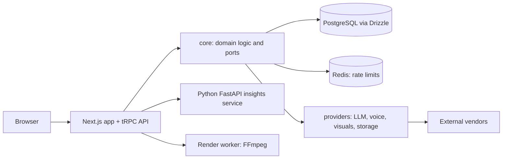

# Tillercast

**A video SaaS I am building solo, with its delivery pipeline treated as a first-class part of the product.**

Tillercast plans, produces and publishes short-form video from a short interview. A creator answers a few questions, reviews a free script draft, previews the result, and only then spends credits on the final render. The source code is private (proprietary), so this page documents the engineering: how it is built, shipped and kept from breaking. I am happy to walk through the real code in an interview.

> Status: in active development. The pipeline below is built and tested; items marked *in progress* are not finished. Nothing here is presented as having paying users.

## Architecture

A pnpm and Turborepo monorepo:

| Package | Responsibility |
|---|---|
| `apps/web` | Next.js app and tRPC API |
| `packages/core` | Domain logic and ports. No framework or database imports |
| `packages/db` | Drizzle schema and versioned Postgres migrations |
| `packages/providers` | Adapters for LLM, voice, visuals and storage |
| `packages/ui` | Design system |
| `services/insights` | Python FastAPI service, shipped as a Docker image |

Architecture decisions are written down as ADRs (21 so far), for example the credit ledger, the production pipeline, the credits-in-tenths migration and the billing provider port.

## CI/CD and delivery

**Continuous integration** runs on every push and pull request (GitHub Actions):

- Secret scan with gitleaks over the full history
- Node 20 and 22 matrix against real PostgreSQL (pgvector) and Redis service containers
- Format check, lint and typecheck
- Migrations applied to a fresh database, then unit and integration tests
- **Schema-drift gate:** regenerate migrations and fail the build if the committed SQL differs
- Production build, then Playwright end-to-end tests against it
- A separate job for the Python insights service: ruff, pytest and a container image build
- Concurrency control cancels superseded runs; workflow permissions default to read-only

**Continuous delivery:** version tags (`vMAJOR.MINOR.PATCH`) build the insights image with Buildx and layer caching, push it to GitHub Container Registry, and create a GitHub release with notes generated from commits.

**Local guard rails:** Conventional Commits enforced by commitlint and Husky, a pre-commit hook that blocks any staged `.env*` file (except the names-only example) and a pre-push hook that runs typecheck and tests.

## Database and migration safety

- Migrations are versioned SQL generated by Drizzle. Editing an applied migration is forbidden, and CI fails on drift.
- Production migrations run through the Supabase Session pooler.
- A data migration that rescaled every credit balance to tenths of a credit runs in **one transaction**, and is guarded twice against running again: Drizzle's journal and a marker row it checks before touching data. Its rollout notes require draining workers first, because replaying an old idempotency key with new units would conflict.

## Money: an append-only ledger

Credits move only through a double-entry ledger with **reserve, capture and release holds**, a unique idempotency key on every operation, and database triggers that make entries append-only and keep each transaction zero-sum. Credits are reserved before an expensive run, captured at actual cost on success and released if the run fails. A reaper releases holds for runs stuck after a worker crash. Property-based and concurrent Postgres tests cover the ledger.

## Reliability and security

- Every outside vendor sits behind a port, a **circuit breaker** and a **cost meter** that records cost and latency per call
- Configuration is validated by one zod schema and fails fast at startup; there are no secret defaults
- Strict tenant scoping on every query (401 not signed in, 404 missing, 403 not yours)
- zod validation on every API input, webhook payload and LLM output
- Redis-backed rate limiting on sign-in and expensive endpoints
- Passwords hashed with scrypt, sessions stored hashed, session rotation at sign-in, CSP and security headers
- Structured JSON logging with request IDs, a deep health check (Postgres and Redis) and error reporting behind a port

## How it is built

I work trunk-based on `main` in small verified commits and run the checks above before every push. Parts of the code are written with AI coding agents under a review chain: automated gates (typecheck, tests, lint, build) must pass before any human review.

## In progress

- Publishing to YouTube and TikTok
- Zero-downtime expand-and-contract migrations
- Billing provider integration and a background worker platform

## Stack

TypeScript, Next.js, tRPC, Drizzle, PostgreSQL, Redis, Python, FastAPI, Docker, GitHub Actions, GHCR, Playwright, Vitest, FFmpeg, Terraform-free so far (hosting on Netlify and Supabase).

---

Built by [Rayyan Mustafa](https://github.com/rayyan-mustafa), computer science student at SZABIST Islamabad.
